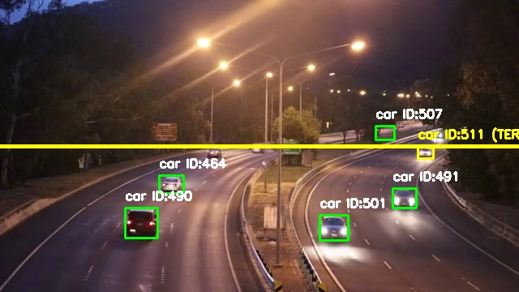

# Traffic Analyst PRO

Aplikasi web untuk analisis lalu lintas: deteksi dan penghitungan kendaraan secara real-time dari live stream YouTube, serta pemrosesan video on-demand.



## Fitur

- **Dashboard Live** — streaming video dari YouTube, penghitungan kendaraan melewati garis deteksi, dan statistik real-time (FPS, status database, total per jenis kendaraan) yang diperbarui tiap 2 detik.
- **Ganti Sumber Stream** — URL YouTube dapat diganti kapan saja lewat dashboard; mengganti URL otomatis mereset hitungan dan memulai sesi pemantauan baru.
- **Pemrosesan Video On-Demand** — unggah file video atau tautan YouTube untuk dianalisis di latar belakang. Setiap event penghitungan disimpan sebagai gambar JPG dan dikompresi menjadi satu file ZIP yang dapat diunduh.
- **Laporan CSV** — ekspor seluruh log deteksi (timestamp, jenis kendaraan, track ID, sumber) sebagai file CSV.

## Arsitektur

Dua alur kerja yang berbagi database yang sama:

1. **Live Stream** — model YOLOv8 kustom (`model/best.pt`, 4 kelas: car, motorcycle, bus, truck) mendeteksi dan melacak kendaraan pada stream; setiap kendaraan yang melewati garis deteksi dicatat ke database.
2. **Pemrosesan Upload** — model YOLOv8n standar (`yolov8n.pt`) memproses video yang diunggah dalam background thread; hasil berupa gambar per event yang dikompresi ke ZIP.

Kedua alur mencatat data ke MySQL:

| Tabel | Isi |
|---|---|
| `traffic_stats` | Total akumulasi per jenis kendaraan (untuk dashboard) |
| `detection_log` | Log timestamp setiap event penghitungan (semua sumber) |

## Teknologi

Python, Flask, Ultralytics YOLOv8, OpenCV, yt-dlp, MySQL, APScheduler.

## Instalasi

Prasyarat: Python 3.11+ dan MySQL (contoh: XAMPP).

```bash
git clone https://github.com/Pashinoh/car-detection-recognition.git
cd car-detection-recognition
pip install -r requirements.txt
```

Import skema database dari `db/traffic_db.sql` (via phpMyAdmin atau `mysql` CLI), lalu sesuaikan koneksi di `DB_CONFIG` pada `app.py` bila perlu.

```bash
python app.py
```

- Dashboard live: `http://127.0.0.1:5000/`
- Halaman upload: `http://127.0.0.1:5000/upload`

## Catatan

- File yang diunggah dan hasil ZIP dihapus otomatis oleh APScheduler beberapa menit setelah dibuat, sehingga folder `uploads/` tidak menumpuk.
- File `yolov8n.pt` diunduh otomatis oleh Ultralytics saat pertama kali aplikasi dijalankan.
